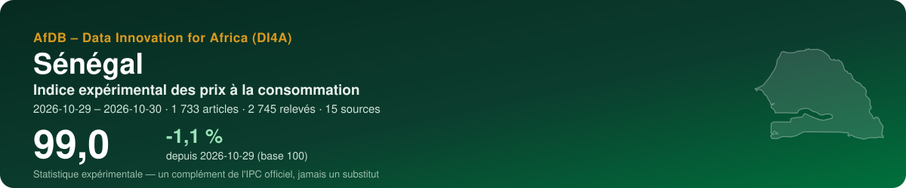
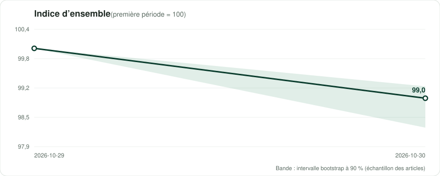
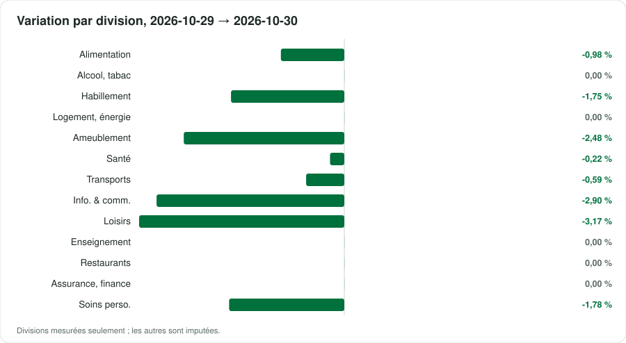
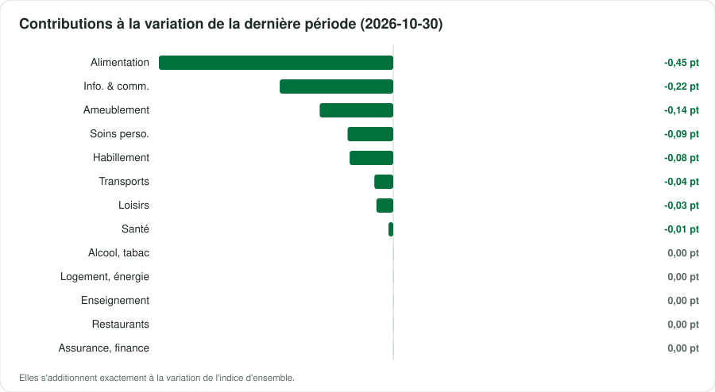

<p align="center"></p>

<p align="center">
  <a href="https://traore225.github.io/ATI_BDMS2026/"><b>▶ Ouvrir le tableau de bord</b></a> · <a href="README.md">English version</a>
</p>

<p align="center">
      
</p>

## En bref

| Indicateur | Valeur |
|---|---|
| **Indice d'ensemble** | **99,0** (-1,1 % depuis 2026-10-29) |
| Variation de la dernière période | -1,05 % |
| Fenêtre | 2026-10-29 → 2026-10-30 · par date de collecte |
| Données | 2 745 relevés · 1 733 articles · 15 sources |
| Divisions COICOP mesurées | 13 / 13 |
| Pondérations | officielles — ANSD, IHPC base 2023 = 100, COICOP 2018 (NCOA 2018), release of February 2026, Tableau 1 'L'indice global et les treize (13) divisions', col |
| Devise | XOF (FCFA) |

> [!IMPORTANT]
> Statistique expérimentale construite à partir de prix publiés en ligne (boutiques, régulateurs, services publics, données de marché). Un complément de l'indice officiel des prix de l'institut national de la statistique — jamais un substitut.

<p align="center"></p>

## Messages clés

| Confiance | Message | Pourquoi |
|---|---|---|
| 🟠 Faible | Entre 2026-10-29 et 2026-10-30, l'indice expérimental a varié de -1,1 % (2 périodes, 1733 articles). | Des dates de collecte dans un seul mois : un mouvement de court terme, pas encore une tendance mensuelle. |
| 🟡 Moyenne | Sur la dernière période, la plus forte contribution vient de la division 01 (Produits alimentaires et boissons non alcoolisées) : -0,45 point de pourcentage. | Les contributions s'additionnent exactement à la variation de l'indice d'ensemble. |
| 🟡 Moyenne | Les divisions mesurées pèsent 100 % du panier officiel. | Être atteint n'est pas être représenté : un groupe peut être suivi par quelques articles en ligne éloignés de ses variétés officielles. Les groupes non mesurés sont imputés par ceux qui le sont. |
| 🟢 Élevée | Sur la dernière période, 89% des prix n'ont pas bougé, 10% ont baissé et 1% ont augmenté : le profil d'une campagne de promotion, pas d'un mouvement général des prix. | Les prix en ligne suivent le calendrier commercial ; plusieurs collectes par mois le lissent. |
| 🟡 Moyenne | Échantillonnage des articles : le dernier indice se situe entre 98,3 et 99,2 dans 90 % de 100 réplications bootstrap. | L'intervalle couvre le choix des articles collectés, pas le biais des prix en ligne face aux prix en magasin. |

## Par division COICOP

<p align="center"></p>

| | Division | Poids % | Articles | Variation % | Contribution, dernière période (pt) |
|---|---|---:|---:|---:|---:|
| 01 | Produits alimentaires et boissons non alcoolisées | 45,5 | 261 | -0,98 | -0,446 |
| 02 | Boissons alcoolisées, tabac et stupéfiants | 0,2 | 48 | 0,00 | 0,000 |
| 03 | Articles d'habillement et chaussures | 4,8 | 146 | -1,75 | -0,083 |
| 04 | Logement, eau, électricité, gaz et autres combustibles | 9,2 | 35 | 0,00 | 0,000 |
| 05 | Meubles, équipements ménagers et entretien courant | 5,7 | 148 | -2,48 | -0,140 |
| 06 | Santé | 4,2 | 140 | -0,22 | -0,009 |
| 07 | Transports | 6,1 | 61 | -0,59 | -0,036 |
| 08 | Information et communication | 7,5 | 254 | -2,90 | -0,216 |
| 09 | Loisirs, sports et culture | 1,0 | 59 | -3,17 | -0,032 |
| 10 | Services d'enseignement | 1,8 | 3 | 0,00 | 0,000 |
| 11 | Restaurants et services d'hébergement | 9,2 | 214 | 0,00 | 0,000 |
| 12 | Assurances et services financiers | 0,1 | 14 | 0,00 | 0,000 |
| 13 | Soins personnels, protection sociale et divers | 4,9 | 205 | -1,78 | -0,087 |

*Imputée* : aucun prix lu pour la division ; elle évolue comme les divisions mesurées (Manuel de l'IPC 2020, ch. 6).

<p align="center"></p>

## Sources

23 sources actives au registre, 5 exclues avec leur motif. Chaque requête du robot lit d'abord le robots.txt ; un refus est consigné, jamais contourné.

| Source | Type | COICOP | Statut | Relevés de cette exécution |
|---|---|---|---|---:|
| [Jumia Sénégal](https://www.jumia.sn) | boutique en ligne | 01, 03, 05, 06, 08, 09, 13 | vérifiée | 991 |
| [Auchan Sénégal — online shop](https://www.auchan.sn) | boutique en ligne | 01, 02, 05, 13 | vérifiée | 793 |
| [Dakar Food Delivery — restaurant menus](https://dakarfooddelivery.com/restaurant) | boutique en ligne | 11 | partielle | 478 |
| [Expat-Dakar — furniture, fashion, multimedia](https://www.expat-dakar.com) | petites annonces | 03, 05, 08 | partielle | 299 |
| [Auchan Sénégal — alcoholic drinks](https://www.auchan.sn/categorie/boissons-alcoolisees) | boutique en ligne | 02 | partielle | 82 |
| [Orange Sénégal — internet passes](https://www.orange.sn/pass-internet) | tarif réglementé | 08 | vérifiée | 24 |
| [Yas (ex-Free) — internet and mixed bundles](https://www.yas.sn/particulier/mobile-plans/internet/) | tarif réglementé | 08 | vérifiée | 24 |
| [TER Dakar and BRT — public transport fares](https://www.terdakar.sn/quel-titre-choisir) | tarif réglementé | 07 | vérifiée | 20 |
| [Fuel and butane retail prices (government and CRSE decisions)](https://primature.sn/publications/communiques-officiels/ajustement-des-prix-des-carburants-compter-du-samedi-15-aout) | tarif réglementé | 07, 04 | vérifiée | 8 |
| [Administered consumer prices — rice, sugar, palm oil, bread (Ministry of Trade)](https://www.primature.sn/publications/communiques-officiels/baisse-du-prix-du-riz-ordinaire-brise) | tarif réglementé | 01 | partielle | 8 |
| [CRSE — Senelec household electricity tariffs](https://www.crse.sn/wp-content/uploads/2025/12/Grilles-tarifaires-Senelec-et-CER-applicables-a-compter-du-1er-janvier-2026.pdf) | tarif réglementé | 04 | vérifiée | 6 |
| [Public universities — annual registration fees (arrêté n° 00533 of 15/01/2015)](https://www.sencampus.com/dossiers/financer-ses-etudes-sans-bourse/combien-coutent-vraiment-des-etudes-au-senegal) | tarif réglementé | 10 | partielle | 6 |
| [Wave — mobile money fees](https://www.wave.com/fr/) | tarif réglementé | 12 | vérifiée | 2 |
| [SEN-PNA — essential generic medicines (public supply price)](https://boutique.sen-pna.sn/) | tarif réglementé | 06 | partielle | 2 |
| [Tax on mobile-money transfers (TTA, 0.5 %)](https://senego.com/mobile-money-la-taxe-sur-les-transferts-dargent-entre-en-vigueur-ce-17-decembre-2025_1903513.html) | tarif réglementé | 12 | partielle | 2 |
| [CRSE — structure of petroleum product prices (change alarm)](https://www.crse.sn) | tarif réglementé | 07, 04 | partielle | 0 |
| [Expat-Dakar — rental listings](https://www.expat-dakar.com/appartements-a-louer) | loyers | 04 | vérifiée | 0 |
| [Keur-Immo — rental listings, Dakar](https://keur-immo.com/senegal/appartements-a-louer-dakar/) | loyers | 04 | vérifiée | 0 |
| [WFP market prices (HDX) — history](https://data.humdata.org/dataset/wfp-food-prices-for-senegal) | prix de marché | 01 | partielle | 0 |
| [World Bank RTFP — monthly cereal prices and food price index (67 markets)](https://microdata.worldbank.org/index.php/catalog/6173) | prix de marché | 01 | vérifiée | 0 |
| [FEWS NET Data Warehouse — market prices (Senegal)](https://fews.net/west-africa/senegal) | prix de marché | 01 | non vérifiée | 0 |
| [World Bank — official CPI (annual)](https://api.worldbank.org/v2/country/SEN/indicator/FP.CPI.TOTL) | référence officielle | — | vérifiée | 0 |
| [IMF DataMapper — inflation (WEO)](https://www.imf.org/external/datamapper/api/v1/PCPIPCH/SEN) | référence officielle | — | vérifiée | 0 |

<details><summary>5 sources exclues et pourquoi</summary>

- **Glovo Dakar** — Le robots l'autorise, mais les pages de Dakar ont répondu des erreurs (protection anti-robots, menus en JavaScript). Dakar Food Delivery (sn_dakarfood) est utilisé à la place.
- **SEN'EAU water tariffs** — Revu le 28/10/2026 : la page des tarifs ne donne les tranches au m³ qu'en deux images (zones assainies / non assainies), et l'arrêté ministériel (893-MEA « portant révision des tarifs de l'eau », mis en ligne en juillet 2025) est un PDF scanné sans couche texte. Aucun chiffre lisible, donc aucun saisi : à reporter à la main depuis l'arrêté, une fois par révision.
- **ANSD (direct)** — Le robots.txt a refusé le client ; les publications IHPC sont lues sur le miroir vie-publique.sn.
- **CoinAfrique SN** — Le robots.txt porte Disallow: /?* — les URL paginées peuvent y tomber ; l'occasion domine.
- **Private school fees (press reports)** — Lu le 28/10/2026 : il n'existe pas de barème homologué (Senego 21/09/2026) ; les seuls chiffres 2026-27 sont des témoignages de parents (Thiès : inscription 80 000 F, 16 500 F/mois) et quelques écoles d'élite de Dakar (Le360 05/10/2026 : Saint-Exupéry 2 000 000 F/an ; Mission libanaise 100 000 F/mois). Éléments isolés et non représentatifs : non utilisés. Les frais moyens par niveau sont demandés à l'ANSD.

</details>

## Méthode

Articles appariés ; indices élémentaires de **Jevons** par classe COICOP 2018, points de vente en strates de poids égal ; imputation explicite des prix manquants (deux périodes au plus, onze pour les produits saisonniers) ; remplacements raccordés avec ajustement de quantité ; agrégation avec les poids officiels sous forme **Young/Lowe**, chaînée ; GEKS pour contrôler la dérive de chaînage ; intervalle bootstrap à 90 %. Comme le prescrit le *Manuel de l'indice des prix à la consommation* (FMI et al., 2020). Détails : [docs/METHODOLOGIE.md](docs/METHODOLOGIE.md).

## Données

Copies ouvertes, lisibles par machine, de ce que montre le tableau de bord :

- [`data/index_all_items.csv`](data/index_all_items.csv) — indice d'ensemble par période, avec son intervalle à 90 %
- [`data/index_divisions.csv`](data/index_divisions.csv) — indice de chaque division mesurée
- [`data/contributions.csv`](data/contributions.csv) — contributions des divisions à chaque variation, en points
- [`data/basket.csv`](data/basket.csv) — poids, articles et variation par division
- [`data/sources.csv`](data/sources.csv) — le registre des sources et ce que l'exécution a obtenu de chacune
- [`data/metadata.json`](data/metadata.json) — pays, périodes, pondérations et chiffres clés

## Reproduire

L'indice est produit par la boîte à outils ouverte **cpi-di4a** en deux notebooks : le notebook 1 collecte poliment les prix (robots.txt d'abord, robot identifié) et les scelle dans une archive ; le notebook 2 classe, calcule et publie ce dépôt. Choisissez le code pays, *Exécution → Tout exécuter*.

## Citer

```text
AfDB – Data Innovation for Africa (DI4A) (2026). Indice expérimental des prix à la consommation — Sénégal. https://traore225.github.io/ATI_BDMS2026/
```

Voir aussi [CITATION.cff](CITATION.cff).

---

<p align="center"><sub>AfDB – Data Innovation for Africa (DI4A) · généré le 2026-10-30 · code sous licence MIT ; les données collectées restent soumises aux conditions de chaque source</sub></p>
