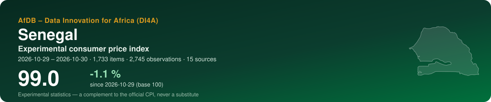
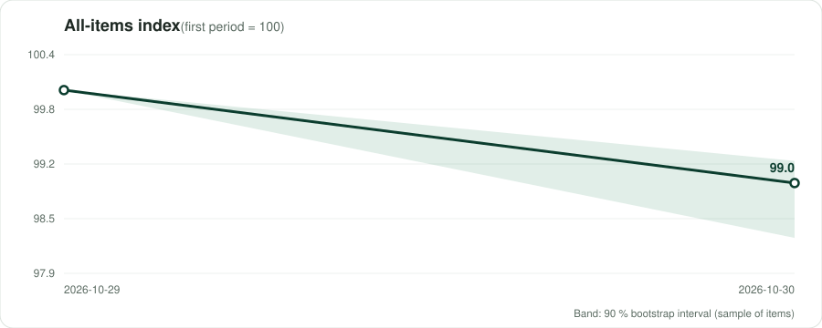
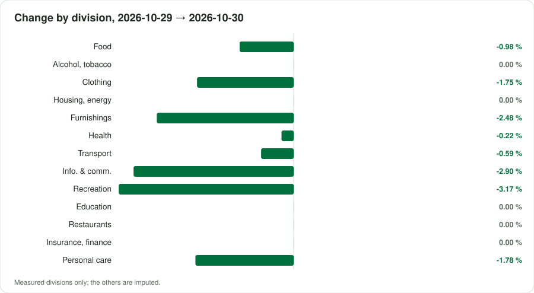
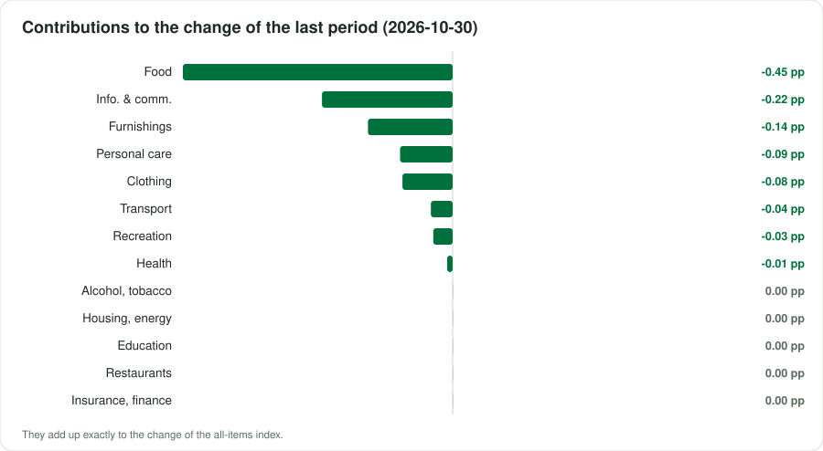

<p align="center"></p>

<p align="center">
  <a href="https://traore225.github.io/ATI_BDMS2026/"><b>▶ Open the live dashboard</b></a> · <a href="README.fr.md">Version française</a>
</p>

<p align="center">
      
</p>

## At a glance

| Indicator | Value |
|---|---|
| **All-items index** | **99.0** (-1.1 % since 2026-10-29) |
| Last period change | -1.05 % |
| Window | 2026-10-29 → 2026-10-30 · by collection date |
| Data | 2,745 observations · 1,733 items · 15 sources |
| COICOP divisions measured | 13 / 13 |
| Weights | official — ANSD, IHPC base 2023 = 100, COICOP 2018 (NCOA 2018), release of February 2026, Tableau 1 'L'indice global et les treize (13) divisions', col |
| Currency | XOF (FCFA) |

> [!IMPORTANT]
> Experimental statistics built from prices published online (shops, regulators, utilities, market data). A complement to the official consumer price index of the national statistics office — never a substitute.

<p align="center"></p>

## Key messages

| Confidence | Message | Why |
|---|---|---|
| 🟠 Low | Between 2026-10-29 and 2026-10-30, the experimental index moved by -1.1 % (2 periods, 1733 items). | Collection dates within a single month: a short-term movement, not yet a monthly trend. |
| 🟡 Medium | Over the last period, the largest contribution comes from division 01 (Food and non-alcoholic beverages): -0.45 percentage point. | Contributions add up exactly to the change of the all-items index. |
| 🟡 Medium | The divisions measured weigh 100 % of the official basket. | Being reached is not being represented: a group can be followed through a few online items far from its official varieties. Unmeasured groups are imputed by the measured ones. |
| 🟢 High | Over the last period, 89% of prices did not move, 10% fell and 1% rose: the pattern of a promotion campaign, not of general price movement. | Online prices react to commercial calendars; several collections per month smooth this out. |
| 🟡 Medium | Sampling of items: the latest index lies between 98.3 and 99.2 in 90 % of 100 bootstrap replications. | The interval covers which items were collected, not the bias of online prices against shop prices. |

## By COICOP division

<p align="center"></p>

| | Division | Weight % | Items | Change % | Contribution, last period (pp) |
|---|---|---:|---:|---:|---:|
| 01 | Food and non-alcoholic beverages | 45.5 | 261 | -0.98 | -0.446 |
| 02 | Alcoholic beverages, tobacco and narcotics | 0.2 | 48 | 0.00 | 0.000 |
| 03 | Clothing and footwear | 4.8 | 146 | -1.75 | -0.083 |
| 04 | Housing, water, electricity, gas and other fuels | 9.2 | 35 | 0.00 | 0.000 |
| 05 | Furnishings, household equipment and maintenance | 5.7 | 148 | -2.48 | -0.140 |
| 06 | Health | 4.2 | 140 | -0.22 | -0.009 |
| 07 | Transport | 6.1 | 61 | -0.59 | -0.036 |
| 08 | Information and communication | 7.5 | 254 | -2.90 | -0.216 |
| 09 | Recreation, sport and culture | 1.0 | 59 | -3.17 | -0.032 |
| 10 | Education services | 1.8 | 3 | 0.00 | 0.000 |
| 11 | Restaurants and accommodation services | 9.2 | 214 | 0.00 | 0.000 |
| 12 | Insurance and financial services | 0.1 | 14 | 0.00 | 0.000 |
| 13 | Personal care, social protection and miscellaneous | 4.9 | 205 | -1.78 | -0.087 |

*Imputed*: no price was read for the division; it moves with the measured ones (CPI Manual 2020, ch. 6).

<p align="center"></p>

## Sources

23 active sources in the register, 5 excluded with their reason. Every robot request reads robots.txt first; a refusal is recorded, never circumvented.

| Source | Type | COICOP | Status | Observations this run |
|---|---|---|---|---:|
| [Jumia Sénégal](https://www.jumia.sn) | online shop | 01, 03, 05, 06, 08, 09, 13 | verified | 991 |
| [Auchan Sénégal — online shop](https://www.auchan.sn) | online shop | 01, 02, 05, 13 | verified | 793 |
| [Dakar Food Delivery — restaurant menus](https://dakarfooddelivery.com/restaurant) | online shop | 11 | partial | 478 |
| [Expat-Dakar — furniture, fashion, multimedia](https://www.expat-dakar.com) | classifieds | 03, 05, 08 | partial | 299 |
| [Auchan Sénégal — alcoholic drinks](https://www.auchan.sn/categorie/boissons-alcoolisees) | online shop | 02 | partial | 82 |
| [Orange Sénégal — internet passes](https://www.orange.sn/pass-internet) | regulated tariff | 08 | verified | 24 |
| [Yas (ex-Free) — internet and mixed bundles](https://www.yas.sn/particulier/mobile-plans/internet/) | regulated tariff | 08 | verified | 24 |
| [TER Dakar and BRT — public transport fares](https://www.terdakar.sn/quel-titre-choisir) | regulated tariff | 07 | verified | 20 |
| [Fuel and butane retail prices (government and CRSE decisions)](https://primature.sn/publications/communiques-officiels/ajustement-des-prix-des-carburants-compter-du-samedi-15-aout) | regulated tariff | 07, 04 | verified | 8 |
| [Administered consumer prices — rice, sugar, palm oil, bread (Ministry of Trade)](https://www.primature.sn/publications/communiques-officiels/baisse-du-prix-du-riz-ordinaire-brise) | regulated tariff | 01 | partial | 8 |
| [CRSE — Senelec household electricity tariffs](https://www.crse.sn/wp-content/uploads/2025/12/Grilles-tarifaires-Senelec-et-CER-applicables-a-compter-du-1er-janvier-2026.pdf) | regulated tariff | 04 | verified | 6 |
| [Public universities — annual registration fees (arrêté n° 00533 of 15/01/2015)](https://www.sencampus.com/dossiers/financer-ses-etudes-sans-bourse/combien-coutent-vraiment-des-etudes-au-senegal) | regulated tariff | 10 | partial | 6 |
| [Wave — mobile money fees](https://www.wave.com/fr/) | regulated tariff | 12 | verified | 2 |
| [SEN-PNA — essential generic medicines (public supply price)](https://boutique.sen-pna.sn/) | regulated tariff | 06 | partial | 2 |
| [Tax on mobile-money transfers (TTA, 0.5 %)](https://senego.com/mobile-money-la-taxe-sur-les-transferts-dargent-entre-en-vigueur-ce-17-decembre-2025_1903513.html) | regulated tariff | 12 | partial | 2 |
| [CRSE — structure of petroleum product prices (change alarm)](https://www.crse.sn) | regulated tariff | 07, 04 | partial | 0 |
| [Expat-Dakar — rental listings](https://www.expat-dakar.com/appartements-a-louer) | rents | 04 | verified | 0 |
| [Keur-Immo — rental listings, Dakar](https://keur-immo.com/senegal/appartements-a-louer-dakar/) | rents | 04 | verified | 0 |
| [WFP market prices (HDX) — history](https://data.humdata.org/dataset/wfp-food-prices-for-senegal) | market prices | 01 | partial | 0 |
| [World Bank RTFP — monthly cereal prices and food price index (67 markets)](https://microdata.worldbank.org/index.php/catalog/6173) | market prices | 01 | verified | 0 |
| [FEWS NET Data Warehouse — market prices (Senegal)](https://fews.net/west-africa/senegal) | market prices | 01 | unverified | 0 |
| [World Bank — official CPI (annual)](https://api.worldbank.org/v2/country/SEN/indicator/FP.CPI.TOTL) | official benchmark | — | verified | 0 |
| [IMF DataMapper — inflation (WEO)](https://www.imf.org/external/datamapper/api/v1/PCPIPCH/SEN) | official benchmark | — | verified | 0 |

<details><summary>5 excluded sources and why</summary>

- **Glovo Dakar** — Robots allows it, but the Dakar pages answered fetch errors (bot protection, JavaScript menus). Dakar Food Delivery (sn_dakarfood) is used instead.
- **SEN'EAU water tariffs** — Re-checked 28/10/2026: the tariff page shows the per-m³ tranches only as two images (zones with / without sewerage), and the ministerial order (893-MEA 'portant révision des tarifs de l'eau', uploaded July 2025: https://www.seneau.sn/wp-content/uploads/2025/07/893-MEA-Arrete-portant-revision-des-tarifs-de-leau.pdf) is a scanned PDF with no text layer. No figure could be read, so none is entered: to be typed in by hand from the order, once per revision.
- **ANSD (direct)** — robots.txt refused the fetcher; IHPC releases are read on the vie-publique.sn mirror.
- **CoinAfrique SN** — robots.txt has Disallow: /?* — paginated URLs may fall under it; second-hand goods dominate.
- **Private school fees (press reports)** — Read 28/10/2026: no homologated fee scale exists (Senego 21/09/2026); the only 2026-27 figures are parent testimonies (Thiès: registration 80,000 F, 16,500 F/month) and a few elite Dakar schools (Le360 05/10/2026: Saint-Exupéry 2,000,000 F/year; Mission libanaise 100,000 F/month). Isolated, unrepresentative items: not used. Average fees by level are requested from ANSD.

</details>

## Method

Matched items; elementary **Jevons** indices by COICOP 2018 class, outlets as equal-weight strata; explicit imputation of missing prices (two periods at most, eleven for seasonal items); replacements linked with a quantity adjustment; aggregation with official weights in the **Young/Lowe** form, chained; GEKS as a chain-drift check; a 90 % bootstrap interval. As prescribed by the *Consumer Price Index Manual: Concepts and Methods* (IMF et al., 2020). Details: [docs/METHODOLOGY.md](docs/METHODOLOGY.md).

## Data

Open, machine-readable copies of what the dashboard shows:

- [`data/index_all_items.csv`](data/index_all_items.csv) — all-items index by period, with its 90 % interval
- [`data/index_divisions.csv`](data/index_divisions.csv) — index of each measured division
- [`data/contributions.csv`](data/contributions.csv) — contributions of the divisions to each change, in percentage points
- [`data/basket.csv`](data/basket.csv) — weights, items and change by division
- [`data/sources.csv`](data/sources.csv) — the source register and what this run obtained from each source
- [`data/metadata.json`](data/metadata.json) — country, periods, weights and key figures

## Reproduce

The index is produced by the open toolkit **cpi-di4a** in two notebooks: notebook 1 collects prices politely (robots.txt first, identified robot) and seals them in an archive; notebook 2 classifies, computes and publishes this repository. Set the country code, *Runtime → Run all*.

## Cite

```text
AfDB – Data Innovation for Africa (DI4A) (2026). Experimental consumer price index — Senegal. https://traore225.github.io/ATI_BDMS2026/
```

See also [CITATION.cff](CITATION.cff).

---

<p align="center"><sub>AfDB – Data Innovation for Africa (DI4A) · generated on 2026-10-30 · code under MIT licence; collected data remain subject to each source's terms</sub></p>
